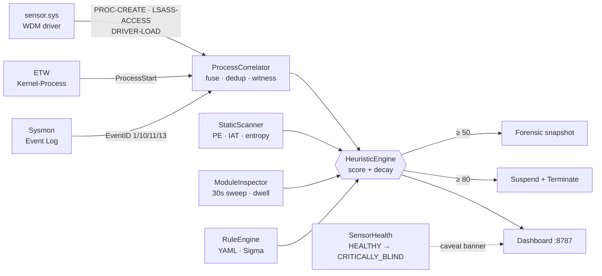

<div align="center">

# Trinetra

**त्रिनेत्र · The Three-Eyed**

*A Windows EDR built on the one insight most tools miss: no single telemetry source sees the full picture.*


</div>

---

Every Windows telemetry source lies by omission. Sysmon sees rich process fields but cannot verify a process’s claimed parent. ETW’s `Kernel-Process` provider (`{22fb2cd6}`) carries no `CommandLine` or `ParentImage` — a permanent API constraint confirmed across 35 live captures on Windows 11 build 26100, every one `null`. The kernel sees ground truth the other two cannot, but has no command line. No individual sensor covers more than 3 of 5 attack scenarios in ablation testing. **Fusion is the only configuration that reaches 5/5.**

Trinetra instruments all three simultaneously, fuses them through a correlated scoring engine, and knows when it is being blinded.

---

## Architecture



Each sensor operates independently. One going dark degrades the configuration — it does not halt detection.

---

## What each sensor sees

| Field | Sysmon | ETW | Kernel driver |
|---|:-:|:-:|:-:|
| `CommandLine` | ✅ | ❌ | ❌ |
| `ParentImage` path | ✅ | ❌ | ❌ |
| Claimed parent PID | ✅ | ✅ | ✅ |
| **Real** creator PID | ❌ | ⚠️ | ✅ ground truth |
| LSASS handle requests | ❌ PPL blocks | ❌ | ✅ pre-operation |
| Kernel driver loads | ❌ | ❌ | ✅ real-time |
| Cross-sensor contradiction | — | — | ✅ |

The ETW and Sysmon blind spots are structural — no configuration change closes them. The kernel driver closes both, while Sysmon provides the command-line visibility the kernel lacks. Fusion is the only complete picture.

---

## Sensor ablation study

Five attack scenarios run against each sensor configuration in isolation, then fused. Tested live on **Windows 11 build 26100** (`attack_run_20261031_223251`).

| Scenario | MITRE | All Three | Kernel only | Sysmon only | ETW only |
|---|---|:-:|:-:|:-:|:-:|
| PPID Spoof | T1134.004 | ✅ (80) | ✅ (80) | ❌ | ❌ |
| LSASS Access (pre-PPL) | T1003.001 | ✅ (70) | ✅ (70) | ❌ | ❌ |
| Kernel Driver Load | — | ✅ (20) | ✅ (20) | ❌ | ❌ |
| Defender Tamper | T1562.001 | ✅ (90) | ❌ | ✅ (90) | ❌ |
| Office LOLBin | T1204.002 | ✅ (60) | ❌ | ✅ (60) | ❌ |
| **Coverage** | | **5 / 5** | **3 / 5** | **2 / 5** | **0 / 5** |

Each ❌ is a structural guarantee:

- **Sysmon** cannot verify the real process creator (`PROC_THREAD_ATTRIBUTE_PARENT_PROCESS` spoofs the claimed parent silently) and PPL rejects LSASS handle requests before EventID 10 can fire.
- **Kernel driver** carries no command line — `PsSetCreateProcessNotifyRoutineEx` simply does not provide it. Command-line-dependent detections structurally cannot fire.
- **ETW alone scores 0/5.** `ProcessStart` exposes five fields. `CommandLine` and `ParentImage` are absent from the provider manifest — not configurable, not fixable. 35 live events confirmed: both `null` on every one.

---

## Key capabilities

- **Kernel-verified PPID detection** — `PsSetCreateProcessNotifyRoutineEx` reads the real creator PID that `PROC_THREAD_ATTRIBUTE_PARENT_PROCESS` cannot influence. Sysmon and ETW only see the spoofed claim.

- **Pre-operation LSASS access detection** — `ObRegisterCallbacks` on `PsProcessType` fires before the handle is granted, observing credential-access attempts that Sysmon cannot see.

- **Cross-sensor contradiction detection** — when ETW and Sysmon report the same process but disagree on the parent PID, a `[TELEMETRY_CONTRADICTION]` alert fires. Never silently resolved.

- **Per-event sensor blindspot detection** — if the kernel driver and ETW disagree on whether a process was created within a 5-second window, a `[SENSOR-BLINDSPOT]` alert fires. Detects ETW session tampering per event, not on a 60-second heartbeat.

- **Driver-level self-protection** — `ObRegisterCallbacks` strips `PROCESS_TERMINATE`, `PROCESS_VM_WRITE`, and `PROCESS_CREATE_THREAD` from any external handle opened to the agent. `taskkill /F` and injection attempts fail at the kernel.

- **Sensor health state machine** — `HEALTHY / DEGRADED / PARTIALLY_BLIND / CRITICALLY_BLIND`. The dashboard qualifies its own “0 alerts” tiles when visibility is reduced — it never silently lies about what it can see.

- **Scored, decaying threat model** — per-process cumulative score with time-based decay (~20 pts/min). Forensic snapshot at 50, suspend + terminate at 80.

- **Static PE analysis** — section entropy, RWX segments, import hash, injection IAT patterns, LSASS dump primitives, C2 string indicators. Parsed from bytes, never executed.

- **Live memory sweep** — anonymous RWX regions, staging-path injected modules, true dwell-time tracking. Runs every 30 seconds.

- **Declarative custom rules** — YAML drop-in to `rules/custom/`; scores through the same engine path as built-in detections, safety floor included.

---

## Detection reference

| Detection | Score | MITRE |
|---|:-:|---|
| Defender service / real-time protection disabled | 90 | T1562.001 |
| Kernel-verified PPID spoofing | 80 | T1134.004 |
| Ransomware-style file-write burst (60 renames / 20 s) | 80 | T1486 |
| LSASS memory access — dangerous access mask | 70 | T1003.001 |
| Office app spawned LOLBin | 60 | T1204.002 |
| `svchost.exe` hollowing-class access | 50 | T1055.012 |
| Obfuscated / download-execute PowerShell | 45 | T1059.001 |
| Run-key persistence write | 40 | T1547.001 |
| Execution from staging directory | 30 | T1036 |
| Kernel-mode driver loaded | 20 | — |
| Injected module / anonymous RWX region | 35–60 | T1055 |
| Static PE findings | 25–70 | various |

Trusted-path discounts apply — a PPID spoof from a known COM broker scores 20 instead of 80; an LSASS access from a System32 binary scores 30 instead of 70. These resolved live false positives against Outlook and VS Code before shipping.

---

## Safety model

Trinetra can terminate processes. The floor exists because of two real incidents: a rule that auto-killed VS Code twice, and a false positive that suspended `csrss.exe` and froze the OS.

- **Hardcoded, not configurable** — the protected-process list, access-mask bitmasks, and tamper patterns are constants. A bad config file cannot loosen them.
- **Protected floor** — PIDs 0 and 4, the agent itself, and core OS processes (`csrss.exe`, `lsass.exe`, `winlogon.exe`, `services.exe`, `svchost.exe`, and others) can never be scored or mitigated.
- **Forensic snapshot before action** — process ancestry chain captured before any mitigation; unrecoverable from a dead process.

To observe without kill risk: comment out `self.mitigate(pid)` in `HeuristicEngine._check_threshold()`.

---

## Installation

> Windows 10/11 x64, Python 3.11+, run **elevated**. Use a disposable VM.

**1. Clone and install dependencies**
```powershell
git clone https://github.com/praneet390/Entity_2.0
cd Entity_2.0
python -m venv .venv
.venv\Scripts\pip install pefile psutil pywin32 pyyaml pywintrace
```

**2. Install Sysmon**
```powershell
Invoke-WebRequest -Uri "https://download.sysinternals.com/files/Sysmon.zip" -OutFile Sysmon.zip
Expand-Archive Sysmon.zip -DestinationPath tools\sysmon -Force
cd tools\sysmon; .\Sysmon64.exe -accepteula -i ..\..\tools\sysmon\config.xml
```

**3. Install the kernel driver** *(optional — without it, the agent runs on Sysmon + ETW only)*

Run once as Administrator, reboot once:
```bat
install.bat
```

**4. Optional threat-intel enrichment** — MalwareBazaar metadata only; binaries are never downloaded.
```powershell
$env:MALWAREBAZAAR_AUTH_KEY = "..."   # free key from auth.abuse.ch; never commit it
python tools\threat_intel_sync.py --recent 100
```

---

## Usage

```powershell
# Live dashboard — http://127.0.0.1:8787
cd src
..\.venv\Scripts\python.exe web_server.py

# Headless agent
..\.venv\Scripts\python.exe main.py

# Failure-injection lab
python failure_lab.py

# Tests
python -m pytest
```

---

## Project layout

```
src/             agent, sensors, correlator, engine, dashboard server
  webapp/        dashboard frontend
driver/sensor/   sensor.c, sensor.sys, EntityDriverCert.cer
rules/           sigma.yml, static.yar, family_signatures.yar, custom/
config/          detection.yml
tools/           extract_features.py, threat_intel_sync.py, sysmon/config.xml
data/            binaries.json, known_imphashes.json
install.bat      one-shot driver cert + test-signing setup
```
