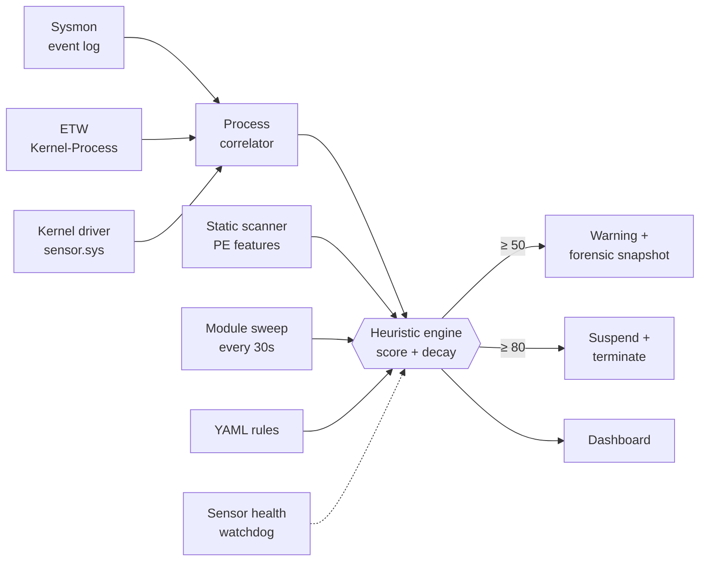

<div align="center">

# Windows Defensive Agent

**A multi-sensor Windows EDR with provable sensor fusion — built to close the gaps attackers depend on.**

Sysmon, raw ETW and a custom WDM kernel driver, fused into one scored detection engine and ablation-tested against their own structural blind spots.


</div>

---

Every Windows telemetry source lies by omission. Sysmon reports only a process's *claimed* parent — `PROC_THREAD_ATTRIBUTE_PARENT_PROCESS` spoofs it silently. ETW's `Kernel-Process` provider carries no `CommandLine` or `ParentImage` — a permanent API constraint, not a config gap. PPL blocks Sysmon EventID 10 on LSASS before the callback fires. This agent instruments all three planes simultaneously, fuses them through a correlated scoring engine, and quantifies exactly which TTP classes each sensor cannot observe — and proves fusion closes every gap.

## Key features

* **Tri-sensor fusion**: Sysmon (rich userspace fields), ETW `Microsoft-Windows-Kernel-Process` (low-latency process telemetry) and a WDM kernel driver (`PsSetCreateProcessNotifyRoutineEx` + `ObRegisterCallbacks`), correlated per-PID through a fused dispatch pipeline.
* **Cross-sensor contradiction detection**: ETW and Sysmon creator PIDs are compared on every process creation — a mismatch is logged as `[TELEMETRY_CONTRADICTION]`, not silently resolved.
* **Per-event blind-spot detection**: if the kernel driver and ETW disagree on a process creation within a 5-second witness window, it surfaces as `[SENSOR-BLINDSPOT]` — early warning of sensor tampering or ETW session hijack.
* **Sensor health telemetry**: real-time state machine — `HEALTHY / DEGRADED / PARTIALLY_BLIND / CRITICALLY_BLIND` — with the dashboard qualifying its own "0 alerts" tiles when visibility is reduced. The EDR knows when it is being blinded.
* **Scored, decaying threat model**: per-process cumulative score with time-based decay; forensic snapshot at 50, suspend + terminate at 80, behind a hardcoded protected-process floor that cannot be overridden from config.
* **Driver-level self-protection**: `ObRegisterCallbacks` strips `PROCESS_TERMINATE` and `PROCESS_VM_WRITE` from any handle opened to the agent process — `taskkill /F` and injection both fail at the kernel.
* **Static PE analysis**: section entropy, import hash, RWX segments, AMSI/ETW-patch IAT patterns, metamorphic-clone detection. Parsed from bytes, never executed.
* **Live memory sweep**: anonymous RWX regions (shellcode-shaped), injected modules and staged DLLs, with first-seen dwell time — runs every 30 seconds.
* **Declarative detection rules**: YAML drop-in to `rules/custom/`; scores through the same engine path as built-in detections, safety floor included.

## Architecture



### What each sensor sees

| | Sysmon | ETW | Kernel driver |
|---|:-:|:-:|:-:|
| Command line | ✅ | ❌ | ❌ |
| Parent image path | ✅ | ❌ | ❌ |
| Claimed parent PID | ✅ | ✅ | ✅ |
| **Real** creator PID | ❌ | ⚠️ | ✅ |
| LSASS handle requests (pre-PPL) | ❌ | ❌ | ✅ |
| Kernel driver loads | ❌ | ❌ | ✅ |

ETW's event header carries the creating process and is read and cross-checked against the driver, but scoring on it is off by default until verified per-host.

### Detections

| Detection | Score | Technique |
|---|:-:|---|
| Defender tampering command line | 90 | T1562.001 |
| Kernel-verified PPID spoofing | 80 (20 if creator is a System32 broker) | T1134.004 |
| Ransomware-style file-write burst | 80 | T1486 |
| LSASS access | 70 (30 if caller is in System32) | T1003.001 |
| Office app → shell / script host | 60 | T1204.002 |
| `svchost.exe` hollowing-style access | 50 (15 if trusted) | T1055.012 |
| Obfuscated / download-execute PowerShell | 45 | T1059.001 |
| Run-key persistence | 40 | T1547.001 |
| Execution from staging directory | 30 | T1036 |
| Kernel driver loaded | 20 | — |
| Injected module / anonymous RWX region | 35–60 | T1055 |
| Static PE findings | 25–70 | various |

### Safety

The agent can kill processes. Two real incidents shaped it: a ransomware rule that killed an IDE twice, and a false positive that suspended `csrss.exe` and froze the OS.

* **Protected floor**: core OS processes, PIDs 0 and 4, and the agent itself can never be scored or mitigated — enforced in scoring, `mitigate()`, and the driver.
* **Hardcoded constants**: the protected list, access masks and tamper patterns cannot be loosened from config.
* **Trusted-broker discount**: Windows' own COM and app brokers legitimately reparent children. This fixed a false positive that killed a live Outlook.

To observe without any kill risk, comment out `self.mitigate(pid)` in `HeuristicEngine._check_threshold()`.

## Sensor ablation study

Five attack scenarios run against each sensor configuration in isolation, then fused.
Tested live on **Windows 11 build 26100** (`attack_run_20261031_223251`).

| Scenario | MITRE | All Three | Kernel only | Sysmon only | ETW only |
|---|---|:-:|:-:|:-:|:-:|
| PPID Spoof | T1134.004 | ✅ (80) | ✅ (80) | ❌ | ❌ |
| LSASS Access (pre-PPL) | T1003.001 | ✅ (70) | ✅ (70) | ❌ | ❌ |
| Kernel Driver Load | — | ✅ (20) | ✅ (20) | ❌ | ❌ |
| Defender Tamper | T1562.001 | ✅ (90) | ❌ | ✅ (90) | ❌ |
| Office LOLBin | T1204.002 | ✅ (60) | ❌ | ✅ (60) | ❌ |
| **Coverage** | | **5 / 5** | **3 / 5** | **2 / 5** | **0 / 5** |

**Every ❌ is a structural guarantee, not a tuning gap:**

- **Sysmon misses PPID spoof and LSASS** — EventID 1 has no `CreatingThreadId`; PPL rejects `OpenProcess` before EventID 10 can fire.
- **Kernel misses Defender tamper and Office LOLBin** — `PsSetCreateProcessNotifyRoutineEx` carries no `CommandLine` or `ParentImage`; both are `None` on the kernel dispatch path.
- **ETW misses everything** — `Microsoft-Windows-Kernel-Process` (`{22fb2cd6}`) exposes five fields at `ProcessStart`: PID, CreateTime, ParentPID, SessionID, ImageName. `CommandLine` and `ParentImage` are absent from the provider manifest. **35 live events captured on the test host — every one had `CommandLine: null` and `ParentImage: null`.** This is a permanent Windows API constraint, not a configuration gap.

No individual sensor exceeds 3/5 coverage. Fusion is the only configuration that reaches 5/5.

## Installation

> Windows 10/11 x64, Python 3.11+, run **elevated**. Use a disposable VM.

1. **Clone and install dependencies**
   ```powershell
   git clone https://github.com/praneet390/Entity_2.0
   cd Entity_2.0
   python -m venv .venv
   .venv\Scripts\pip install pefile psutil pywin32 pyyaml pywintrace
   ```

2. **Install Sysmon**
   ```powershell
   Invoke-WebRequest -Uri "https://download.sysinternals.com/files/Sysmon.zip" -OutFile Sysmon.zip
   Expand-Archive Sysmon.zip -DestinationPath tools\sysmon -Force
   cd tools\sysmon; .\Sysmon64.exe -accepteula -i config.xml
   ```

3. **Install the kernel driver** *(optional — without it the agent runs on Sysmon and ETW only)*

   The pre-built driver and certificate are included. Run once as Administrator, reboot once:
   ```bat
   install.bat
   ```
   After the reboot the agent starts the driver service automatically on every launch.

4. **Optional threat intel** — metadata only from [MalwareBazaar](https://bazaar.abuse.ch); binaries are never downloaded.
   ```powershell
   $env:MALWAREBAZAAR_AUTH_KEY = "..."
   python tools\threat_intel_sync.py --recent 100
   ```

## Usage

**Dashboard**
```powershell
cd src
..\.venv\Scripts\python.exe web_server.py      # http://127.0.0.1:8787
```

**Headless agent**
```powershell
..\.venv\Scripts\python.exe main.py
```

**Failure-injection lab**
```powershell
python failure_lab.py
```

**Tests**
```powershell
python -m pytest
```

## Configuration

Tunables live in [`config/detection.yml`](config/detection.yml). A missing file falls back to built-in defaults.

**Custom rules** — drop a YAML file in `rules/custom/`:
```yaml
id: custom_lolbin_from_appdata_roaming
applies_to: process_create
technique: T1218
score: 35
match:
  all:
    - { field: image, op: contains, value: "\\appdata\\roaming\\" }
    - { field: image, op: contains, value: [rundll32.exe, regsvr32.exe, mshta.exe] }
message: "LOLBin '{image}' launched from AppData\\Roaming"
```

## Project layout

```
src/        agent, sensors, engine, dashboard server
  webapp/   dashboard frontend
driver/     sensor.c kernel driver
rules/      sigma.yml, static.yar, custom/*.yml
config/     detection.yml
tools/      extract_features.py, threat_intel_sync.py, sysmon/config.xml
data/       binaries.json, known_imphashes.json
reports/    evasion_matrix.md
```
