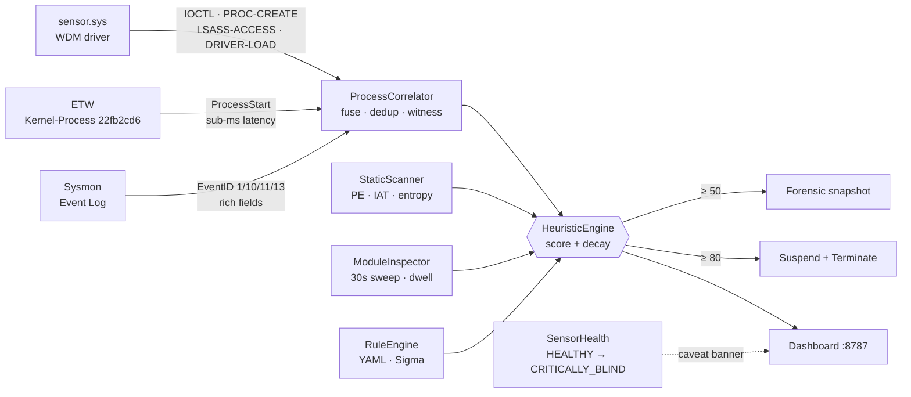

<div align="center">

# Trinetra

**त्रिनेत्र · The Three-Eyed**

*A Windows EDR that instruments the kernel, ETW, and Sysmon simultaneously — then proves, by ablation, that no single sensor is sufficient.*


</div>

---

The premise is straightforward: every Windows telemetry source lies by omission, and those omissions are **structural** — not misconfigurations, not tunables, not vendor oversights. They are permanent API constraints.

`PROC_THREAD_ATTRIBUTE_PARENT_PROCESS` spoofs a process's claimed parent with no kernel notification. Sysmon EventID 1 has no `CreatingThreadId`; it will always report the claim, never the truth. The ETW `Microsoft-Windows-Kernel-Process` provider (`{22fb2cd6}`) exposes exactly five fields at `ProcessStart` — PID, CreateTime, ParentPID, SessionID, ImageName. `CommandLine` and `ParentImage` are **absent from the provider manifest**: not missing by configuration, not filterable, not correctable by subscription flags. Empirically confirmed: 35 live `ProcessStart` events captured on Windows 11 build 26100 — every one had `CommandLine: null`, `ParentImage: null`. PPL blocks Sysmon EventID 10 against `lsass.exe` before the callback fires.

Trinetra instruments all three planes. It fuses their output through a per-PID correlator and quantifies — by ablation — which TTP classes each sensor structurally cannot observe. No individual sensor exceeds 3/5 in the study. Fusion is the only configuration that reaches 5/5.

---

## Architecture



Three independent sensor channels — the driver is polled over an IOCTL device (`\\Device\\malprojectsensor`), ETW events arrive via a bounded queue from a dedicated callback thread, and Sysmon events come from the Windows Event Log subscription. Each operates independently; one going dark degrades the configuration, it does not halt detection.

### What each sensor can and cannot see

| Field | Sysmon | ETW `{22fb2cd6}` | Kernel driver |
|---|:-:|:-:|:-:|
| `CommandLine` | ✅ | ❌ permanent | ❌ permanent |
| `ParentImage` path | ✅ | ❌ permanent | ❌ permanent |
| Claimed parent PID | ✅ | ✅ | ✅ |
| **Real** creator PID (`CreatingThreadId`) | ❌ | ⚠️ header only ¹ | ✅ ground truth |
| LSASS handle requests (pre-PPL enforcement) | ❌ PPL blocks | ❌ | ✅ `ObRegisterCallbacks` |
| Kernel driver loads in real-time | ❌ | ❌ | ✅ `PsSetLoadImageNotifyRoutine` |
| Cross-sensor parent-PID contradiction | — | — | ✅ `[TELEMETRY_CONTRADICTION]` |
| Per-event sensor blindspot | — | — | ✅ `[SENSOR-BLINDSPOT]` |

> ¹ The ETW event header (`EventHeader.ProcessId`) names the creating process — the same field Fibratus and Velociraptor's `Windows.ETW.KernelProcess` artifact use. Whether it reliably agrees with the kernel driver's `CreatingThreadId` is measured live via `witness.creator_agreement` counters. ETW-path PPID-spoof scoring is disabled by default (`etw_creator_scoring: false`) until the agreement counter on the running host validates it; enabling a spoof verdict without that validation can auto-terminate a legitimate process.

---

## Sensor ablation study

Five representative attack scenarios, each run against four sensor configurations in isolation and then fused. Tested live on **Windows 11 build 26100** (run `attack_run_20261031_223251`).

| Scenario | MITRE | All Three | Kernel only | Sysmon only | ETW only |
|---|---|:-:|:-:|:-:|:-:|
| PPID Spoof | T1134.004 | ✅ (80) | ✅ (80) | ❌ | ❌ |
| LSASS Access (pre-PPL) | T1003.001 | ✅ (70) | ✅ (70) | ❌ | ❌ |
| Kernel Driver Load | — | ✅ (20) | ✅ (20) | ❌ | ❌ |
| Defender Tamper | T1562.001 | ✅ (90) | ❌ | ✅ (90) | ❌ |
| Office LOLBin | T1204.002 | ✅ (60) | ❌ | ✅ (60) | ❌ |
| **Coverage** | | **5 / 5** | **3 / 5** | **2 / 5** | **0 / 5** |

**Every ❌ is a structural guarantee, not a tuning gap:**

- **Sysmon misses PPID spoof and LSASS** — EventID 1 has no `CreatingThreadId`; PPL rejects `OpenProcess` on `lsass.exe` before EventID 10 can fire. Neither gap is patchable by Sysmon config.
- **Kernel driver misses Defender tamper and Office LOLBin** — `PsSetCreateProcessNotifyRoutineEx`'s `PPS_CREATE_NOTIFY_INFO` carries no `CommandLine` and no parent image path. Both are `None` on every kernel dispatch path. Command-line-dependent rules structurally cannot fire.
- **ETW misses everything** — `Microsoft-Windows-Kernel-Process` `ProcessStart` exposes five fields. `CommandLine` and `ParentImage` are absent from the provider manifest. **35 live events on Windows 11 build 26100: every one had `CommandLine: null`, `ParentImage: null`.** Permanent Windows API constraint. ETW alone scores 0 / 5.

No individual sensor exceeds 3/5. Fusion reaches 5/5.

---

## Detection engine

### Behavioral detections

| Detection | Score | MITRE |
|---|:-:|---|
| Defender service / real-time protection disabled | 90 | T1562.001 |
| Kernel-verified PPID spoof (untrusted creator) | 80 | T1134.004 |
| Ransomware-style file-write burst (60 renames / 20 s, document dirs) | 80 | T1486 |
| LSASS memory access — dangerous access mask | 70 | T1003.001 |
| Office app spawned LOLBin (macro dropper pattern) | 60 | T1204.002 |
| `svchost.exe` hollowing-class memory access | 50 | T1055.012 |
| Obfuscated / encoded / download-execute PowerShell | 45 | T1059.001 |
| `HKCU\...\Run` persistence write | 40 | T1547.001 |
| Execution from staging directory (`%TEMP%`, `Public`) | 30 | T1036 |
| Kernel-mode driver loaded | 20 | — |
| PPID spoof — real creator is a System32/SysWOW64 broker | 20 | T1134.004 |
| Injected module / anonymous RWX region | 35–60 | T1055 |
| Static PE findings | 25–70 | various |

Scores decay at ≈ 20 points/minute (`SCORE_DECAY_PER_SECOND = 1/3`) so only rapidly compounding signals reach the mitigation threshold. A single low-score signal cannot accumulate to an auto-kill — a live false positive against VS Code (killed twice before the ransomware rule was scoped to document directories) drove this design.

Access events are labeled by injection primitive: `MMAP(RWX)` for `PROCESS_VM_WRITE` / `PROCESS_ALL_ACCESS`, `CREATETHREAD` for `PROCESS_CREATE_THREAD`-only, `OpenProcess(mask)` otherwise — so the forensic snapshot names the attack vector, not just the access mask.

### Static analysis

Parsed from bytes, never executed:

- Section entropy > 7.5 and RWX sections
- `VirtualAllocEx` + `WriteProcessMemory` IAT pair (process-injection primitive)
- `SetWindowsHookExA` + `HttpSendRequestA` pair (keylogger / HTTP exfil)
- `MiniDumpWriteDump` + `OpenProcess` (classic procdump / Mimikatz LSASS dump primitive)
- Hardcoded C2 indicators: Discord webhook URLs, Telegram Bot API, raw Pastebin endpoints, IP-literal HTTP/S (C2 without DNS)
- Metamorphic-clone detection via structural hash comparison across the corpus

### Live memory sweep

Runs every 30 seconds across the live process table:

- **Anonymous executable regions** — tracks the shape `VirtualAlloc(RW)` → write → `VirtualProtect(RX)`. Dwell clock starts when the region first became executable, not at scan time — a shellcode region that sat quiet for two days before a network connection reports its true age.
- **Staging-path modules** — DLLs mapped from `%TEMP%`, `Windows\Temp`, `Users\Public`, `Recycle.Bin` into high-value targets: lsass, svchost, explorer, winlogon, services, spoolsv, dwm.
- LRU-bounded dwell ledger (5 000 entries): evidence survives process death.

---

## Kernel driver

`driver/sensor/sensor.c` — WDM driver, four kernel callbacks registered and torn down independently in `DriverEntry` / `SensorUnload`:

| Callback API | What it provides |
|---|---|
| `PsSetCreateProcessNotifyRoutineEx` | `CreatingThreadId.UniqueProcess` — the real creator PID, immutable to `PROC_THREAD_ATTRIBUTE_PARENT_PROCESS`. Core capability; registration failure fails the driver load. |
| `PsSetCreateThreadNotifyRoutine` | Thread appeared in process X. Building block for cross-process thread-injection detection — correlated with a handle-access signal from the next entry. |
| `PsSetLoadImageNotifyRoutine` | Real-time image loads. `PIMAGE_INFO.SystemModeImage` flag distinguishes a new kernel-mode driver (high signal, enqueued) from a user-mode DLL (logged, not enqueued). |
| `ObRegisterCallbacks` on `PsProcessType` | Pre-operation: fires in the requesting thread's context before the handle is granted. Filtered to `SENSOR_LSASS_DANGEROUS_BITS` against `lsass.exe`. The same bitmask as `heuristic_engine.py`'s Sysmon-driven LSASS check — kept identical so both sensors agree on what is dangerous. |

**Comms channel**: 256-entry circular queue protected by `KSPIN_LOCK` (not a mutex — `ObRegisterCallbacks` pre-op can run at `IRQL ≤ DISPATCH_LEVEL`; a PASSIVE_LEVEL-only lock would bugcheck on the first LSASS-ACCESS event from a raised-IRQL caller). Monotonically increasing sequence numbers expose queue drops to user mode — a gap in the sequence is an explicit event-drop signal.

**Self-protection**: `IOCTL_MALPROJECT_REGISTER_SELF` registers the agent's PID in a kernel-side spinlock-protected array using `PsGetCurrentProcessId()` — never a caller-supplied value, which would be a trivial spoofing vector. `SensorPreOperationCallback` strips `PROCESS_TERMINATE | PROCESS_SUSPEND_RESUME | PROCESS_CREATE_THREAD | PROCESS_VM_OPERATION | PROCESS_VM_WRITE` from any cross-process handle opened to the agent. `taskkill /F` and process-injection attempts both fail at the kernel. Verified live: a `taskkill /F` against a registered PID left the target running through its entire test window.

**Protected-process floor**: `SensorIsProtectedProcess()` ports `heuristic_engine.py`'s `PROTECTED_PROCESS_NAMES` into the driver, using `RtlEqualString` (CaseInSensitive=TRUE) — the correct kernel-mode idiom, not a CRT `_stricmp`. Self-tested at load time via `SensorSelfTestProtectedFloor()` before any blocking capability runs. The floor covers `csrss.exe`, `lsass.exe`, `winlogon.exe`, `services.exe`, `svchost.exe`, `wininit.exe`, `smss.exe`, `dwm.exe`, `explorer.exe`, and PIDs 0 / 4. This predates the LSASS capability — it was added after a live false positive suspended `csrss.exe` and froze the OS.

**PPL honesty note** (empirically verified, not assumed): `ObRegisterCallbacks` pre-op against `lsass.exe` only fires when the caller's protection level is comparable to or higher than LSASS's own PPL level. Unprivileged `OpenProcess(PROCESS_VM_READ)` against `lsass.exe` never reached the callback in three separate test runs — the PPL enforcement happens before any registered Ob callback. The LSASS detection is fully correct and useful for any caller that PPL does not pre-empt.

---

## Cross-sensor fusion

`ProcessCorrelator` runs on three parallel submission paths, each independent:

- **`submit_etw`** — provisional dispatch fires immediately on the scoring thread at sub-ms latency (thin fields, no CommandLine). The event is also recorded for fusion with a later Sysmon arrival.
- **`submit_kernel`** — dispatched immediately and independently. The driver already computed the real creator from `CreatingThreadId` — merging from timestamp-matched user-mode records would be strictly less reliable. Kernel dispatch is never folded into the ETW/Sysmon fusion dict.
- **`submit_sysmon`** — recorded, waits up to `fuse_window` (2 s, configurable) for an ETW pair. If an ETW event arrived first, the fused dispatch carries all of Sysmon's rich fields.

**Cross-sensor contradiction detection**: when both ETW and Sysmon independently report the same PID but disagree on the parent PID, a `[TELEMETRY_CONTRADICTION]` line is logged. The discrepancy is surfaced separately; it is never silently resolved by whichever sensor's field the merge happens to overwrite.

**Witness-gap detection**: the kernel driver and ETW are two independent, unfiltered witnesses to every process creation on the system. If one reports a creation the other does not within 5 seconds, a `[SENSOR-BLINDSPOT]` line fires, naming the silent sensor. This detects ETW session hijacking, `EtwEventWrite` patching, or provider suspension per event — long before the 60-second sensor-health heartbeat staleness would notice.

**Deduplication**: a per-`(pid_key, check_id)` dedup bucket ensures a provisional ETW dispatch and its fused Sysmon follow-up score the same real event once, not twice. Confirmed by a live double-scoring bug: `int 1234 != str "1234"` bypassed dedup across sensors before `_normalize_pid()` was added.

---

## Sensor health and self-awareness

`SensorHealth` tracks each sensor independently. The aggregate blind state qualifies every dashboard tile:

| State | Meaning |
|---|---|
| `HEALTHY` | All sensors live — "0 alerts" can be trusted |
| `DEGRADED` | One sensor stale or dropping — some detections may miss |
| `PARTIALLY_BLIND` | No behavioral sensor live — alert counts say nothing |
| `CRITICALLY_BLIND` | No telemetry observed this session — absence of alerts proves nothing |

A caveat banner appears on the dashboard in any non-HEALTHY state. A sensor that silently loses visibility while the dashboard still shows "0 alerts" is a liability, not a feature; Trinetra says so explicitly and qualifies its own tiles.

---

## Safety model

Trinetra can kill processes. Two real incidents shaped the floor: a ransomware rule that auto-killed VS Code twice, and a false positive that suspended `csrss.exe` and froze the OS.

- **Hardcoded, not configurable**: the protected-process list, access-mask bitmasks (`LSASS_DANGEROUS_BITS`, `HOLLOWING_DANGEROUS_BITS`), and tamper/abuse pattern lists are constants in `heuristic_engine.py` and mirrored in `sensor.c`. A malicious or misconfigured `config/detection.yml` cannot loosen them.
- **Dual enforcement**: the floor is checked in both `_add_score()` and `mitigate()`. `mitigate()` may be called from paths that bypass `_add_score()`, so the redundancy is intentional.
- **Trusted-broker discount**: COM activation, `DcomLaunch`, `RuntimeBroker`, and `dllhost` surrogates legitimately reparent processes via `PROC_THREAD_ATTRIBUTE_PARENT_PROCESS` for taskbar grouping and packaged-app activation. When the kernel-confirmed real creator resolves to a `System32` / `SysWOW64` path, the PPID-spoof score is 20 (logged) rather than 80 (mitigation-eligible). This fixed a live false positive that auto-killed Outlook (olk.exe, olkFullTrustExecutor.exe) on three consecutive test runs.
- **Forensic snapshot before action**: process ancestry chain is captured at the warning threshold and again before `mitigate()`. Ancestry is unrecoverable from `psutil` after termination — the snapshot is the only evidence that survives.

To observe without any kill risk: comment out `self.mitigate(pid)` in `HeuristicEngine._check_threshold()`.

---

## Installation

> Windows 10/11 x64, Python 3.11+, run **elevated**. Use a disposable VM — the driver requires test-signing mode.

**1. Clone and install dependencies**
```powershell
git clone https://github.com/praneet390/Entity_2.0
cd Entity_2.0
python -m venv .venv
.venv\Scripts\pip install pefile psutil pywin32 pyyaml pywintrace
```

**2. Install Sysmon**
```powershell
Invoke-WebRequest -Uri "https://download.sysinternals.com/files/Sysmon.zip" -OutFile Sysmon.zip
Expand-Archive Sysmon.zip -DestinationPath tools\sysmon -Force
cd tools\sysmon; .\Sysmon64.exe -accepteula -i ..\..\tools\sysmon\config.xml
```

**3. Install the kernel driver** *(optional — without it, the agent runs on Sysmon + ETW only)*

Run once as Administrator, reboot once:
```bat
install.bat
```
After the reboot the agent starts the driver service automatically on every launch.

**4. Optional threat-intel enrichment** — MalwareBazaar metadata only; binaries are never fetched.
```powershell
$env:MALWAREBAZAAR_AUTH_KEY = "..."   # free key from auth.abuse.ch; never commit it
python tools\threat_intel_sync.py --recent 100
```

---

## Usage

```powershell
# Live dashboard — http://127.0.0.1:8787
cd src
..\.venv\Scripts\python.exe web_server.py

# Headless agent
..\.venv\Scripts\python.exe main.py

# Failure-injection lab (sensor kill, total silence, drop bursts)
python failure_lab.py

# Test suite
python -m pytest
```

---

## Custom detection rules

Drop a YAML file in `rules/custom/`. It scores through the same engine path as built-in detections — safety floor, dedup, and decay all apply:

```yaml
id: custom_lolbin_from_appdata_roaming
applies_to: process_create
technique: T1218
score: 35
match:
  all:
    - { field: image, op: contains, value: "\\appdata\\roaming\\" }
    - { field: image, op: contains, value: [rundll32.exe, regsvr32.exe, mshta.exe] }
message: "LOLBin '{image}' launched from AppData\\Roaming"
```

---

## Project layout

```
src/             agent, sensors, correlator, engine, dashboard server
  webapp/        dashboard frontend (Chart.js, live polling)
driver/sensor/   sensor.c, sensor.sys, EntityDriverCert.cer
rules/           sigma.yml, static.yar, family_signatures.yar, custom/
config/          detection.yml
tools/           extract_features.py, threat_intel_sync.py, sysmon/config.xml
data/            binaries.json, known_imphashes.json
install.bat      one-shot driver cert + test-signing setup
```
