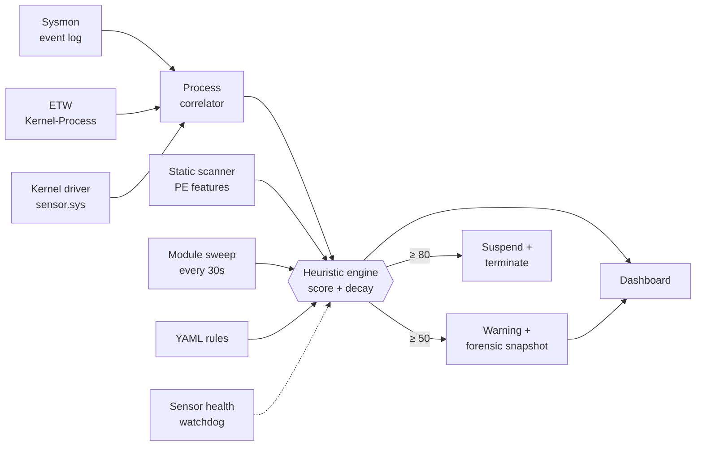

<div align="center">

# Windows Defensive Agent

**A multi-sensor Windows EDR that measures what it can't see.**

Sysmon, raw ETW and a custom kernel driver, fused into one scored engine and tested against their own failure modes.


[Key features](#key-features) · [Architecture](#architecture) · [Installation](#installation) · [Usage](#usage) · [Evasion matrix](#evasion-matrix) · [Comparison](#how-it-compares) · [Deep dive](docs/internals.md)

</div>

---

Every Windows telemetry source lies by omission. Sysmon reports only a
process's *claimed* parent. ETW and a kernel notify routine carry no command
line. PPL hides some LSASS handle requests even from a kernel driver. This agent
runs the sensors side by side, fuses them, and records exactly which attacks each
one misses and whether fusion recovers them.

## Key features

* **Three fused sensors**: Sysmon (rich fields), ETW `Kernel-Process` (low latency, no Sysmon needed) and a WDM kernel driver (real process creator, LSASS handle requests, driver loads), correlated by PID.
* **Sensors that audit each other**: if ETW and Sysmon disagree about a parent PID, it is logged as `[TELEMETRY_CONTRADICTION]` instead of silently resolved.
* **Knows when it is blind**: sensor health reduces to `HEALTHY / DEGRADED / PARTIALLY_BLIND / CRITICALLY_BLIND`, and the dashboard qualifies its own "0 alerts" tiles when visibility is reduced.
* **Scored response**: per-process score with decay; warning at 50, suspend and terminate at 80, behind a hardcoded protected-process floor.
* **Self-protecting**: the driver strips terminate and injection rights from handles to the agent, so `taskkill /F` against it fails.
* **Static analysis**: PE structure, import patterns, entropy, imphash threat intel and metamorphic-clone detection. Samples are parsed, never executed.
* **Active memory sweep**: finds staged DLLs and anonymous RWX (shellcode-shaped) regions, with first-seen dwell time.
* **Forensic ancestry graph**: captured the first time a PID crosses a threshold and kept after the process dies.
* **Declarative rules**: drop a YAML file in `rules/custom/`; no code, no `eval`.
* **Measured, not assumed**: a [live-tested evasion matrix](reports/evasion_matrix.md) and a failure-injection lab that found four real bugs.

## Architecture

The agent works in four phases:

1. **Collect**: Sysmon, ETW and the kernel driver each feed a bounded queue and a separate scoring thread, so a slow rule can never stall event delivery. The static scanner and a 30-second module sweep run alongside.
2. **Correlate**: `ProcessCorrelator` merges ETW and Sysmon events for the same PID: ETW first as *provisional*, then *fused* with Sysmon's richer fields. Kernel events are dispatched independently and deduplicated per PID. A watchdog tracks every sensor's heartbeat and dropped events.
3. **Score**: every finding adds points through one choke point that enforces the protected-process floor, decay and PID-reuse guard. YAML rules score through the same path.
4. **Respond and surface**: crossing a threshold triggers a forensic snapshot, and at 80 a suspend then terminate. Everything is shown on a local dashboard.



### What each sensor sees

| | Sysmon | ETW | Kernel driver |
|---|:-:|:-:|:-:|
| Command line | ✅ | ❌ | ❌ |
| Parent image path | ✅ | ❌ | ❌ |
| Claimed parent PID | ✅ | ✅ | ✅ |
| **Real** creator PID | ❌ | ⚠️ ² | ✅ |
| LSASS handle requests | ✅ ¹ | ❌ | ✅ ¹ |
| Kernel driver loads | ❌ | ❌ | ✅ |
| Needs Sysmon installed | yes | no | no |

¹ Neither sees a non-elevated `OpenProcess` on LSASS: PPL rejects it before any callback runs.
² ETW's event header carries the creating process (Fibratus and Velociraptor both use it), but this agent does not read it yet. That is a gap in this implementation, not an ETW limit; see the [comparison notes](docs/comparison.md#5-correction-to-this-projects-own-matrix).

### Detections

| Detection | Score | Technique |
|---|:-:|---|
| Defender tampering command line | 90 | T1562.001 |
| Kernel-verified PPID spoofing | 80 (20 if creator is a System32 broker) | T1134.004 |
| Ransomware-style file-write burst | 80 | T1486 |
| LSASS access | 70 (30 if caller is in System32) | T1003.001 |
| Office app → shell / script host | 60 | T1204.002 |
| `svchost.exe` hollowing-style access | 50 (15 if trusted) | T1055.012 |
| Obfuscated / download-execute PowerShell | 45 | T1059.001 |
| Run-key persistence | 40 | T1547.001 |
| Execution from staging directory | 30 | T1036 |
| Kernel driver loaded | 20 | n/a |
| Injected module / anonymous RWX region | 35–60 | T1055 |
| Static PE findings (RWX, entropy, injection / LSASS-dump / AMSI / ETW-patch IAT, imphash match, ...) | 25–70 | various |

Sigma and YARA equivalents are in [`rules/`](rules/). A positively identified
Cobalt Strike stager is tagged `[HANDS-ON THREAT]` and pinned to the top of the
dashboard.

### Safety

The agent can kill processes. Two real incidents shaped it: a ransomware rule that
killed an IDE twice, and a false positive that suspended `csrss.exe` and froze the OS.

* **Protected floor**: core OS processes, PIDs 0 and 4, and the agent itself can never be scored or mitigated. Enforced in scoring and again in `mitigate()`, and ported into the driver.
* **Hardcoded constants**: the protected list, access masks and tamper patterns cannot be loosened from the config file.
* **Scoped rules**: command-line rules only inspect processes that execute such commands; the ransomware rule covers user document folders and excludes dev tools.
* **Trusted-broker discount**: Windows' own COM and app brokers legitimately reparent children. This fixed a false positive that killed a live Outlook.

To observe without any kill risk, comment out `self.mitigate(pid)` in
`HeuristicEngine._check_threshold()`.

## Installation

> Windows 10/11 x64, Python 3.11+, run **elevated**. Use a disposable VM if you build the driver.

1. **Clone and install dependencies**
   ```powershell
   git clone https://github.com/praneet390/Entity_2.0
   cd Entity_2.0
   python -m venv .venv
   .venv\Scripts\pip install pefile psutil pywin32 pyyaml pywintrace
   ```

2. **Install Sysmon** (the binaries are not in the repo)
   ```powershell
   Invoke-WebRequest -Uri "https://download.sysinternals.com/files/Sysmon.zip" -OutFile Sysmon.zip
   Expand-Archive Sysmon.zip -DestinationPath tools\sysmon -Force
   cd tools\sysmon; .\Sysmon64.exe -accepteula -i config.xml
   ```

3. **Build the kernel driver** *(optional; without it the agent runs on Sysmon and ETW)*
   * Build `driver/sensor/sensor.vcxproj` (x64, Debug) with Visual Studio and the WDK. Output: `driver/sensor/x64/Debug/sensor.sys`.
   * Sign it with a test certificate and trust that certificate in the VM.
   * Run `bcdedit /set testsigning on` and reboot.

   The agent creates and starts the `sensor` service itself.

4. **Optional threat intel**: metadata only (imphash, family, tags) from [MalwareBazaar](https://bazaar.abuse.ch); sample binaries are never downloaded.
   ```powershell
   $env:MALWAREBAZAAR_AUTH_KEY = "..."   # free key from auth.abuse.ch; never commit it
   python tools\threat_intel_sync.py --recent 100
   ```

## Usage

1. **Dashboard** (self-elevates via UAC, loopback only)
   ```powershell
   cd src
   ..\.venv\Scripts\python.exe web_server.py      # http://127.0.0.1:8787
   ```
   Tabs: Detections, Endpoint Processes (Live status, ancestry Chain, Terminate), Static Analysis, Process Explorer, Rules, plus a visibility badge.

2. **Headless agent**
   ```powershell
   ..\.venv\Scripts\python.exe main.py
   ```

3. **Failure-injection lab**: breaks the telemetry pipeline on purpose and checks detection, fallback and recovery. Software-only, safe anywhere.
   ```powershell
   python failure_lab.py                # all scenarios
   python failure_lab.py --list
   ```

4. **Live VM evaluation**: harmless technique emulations plus a benign corpus, scored against the running agent. **Disposable VM only.**
   ```powershell
   python vm_eval.py --vm
   ```

5. **Attack harnesses**: the programs in `driver/sensor/*_test.c` behind the evasion matrix. Documented Win32 APIs only, nothing destructive.
   ```
   cl.exe /nologo /W4 /EHsc ppid_spoof_test.c /link /OUT:ppid_spoof_test.exe
   ```

6. **Tests**
   ```powershell
   python -m pytest
   ```

Each sensor can fail to start independently; the rest keep working.

## Configuration

* **Tunables** (decay, thresholds, ransomware window, correlator fuse window, self-test interval) live in [`config/detection.yml`](config/detection.yml). A missing file falls back to the built-in defaults.
* **Custom rules**: any YAML file in `rules/custom/`, picked up on the next start:
  ```yaml
  id: custom_lolbin_from_appdata_roaming
  applies_to: process_create   # process_create | process_access | file_create | registry_event | static_pe
  technique: T1218
  score: 35
  match:
    all:
      - { field: image, op: contains, value: "\\appdata\\roaming\\" }
      - { field: image, op: contains, value: [rundll32.exe, regsvr32.exe, mshta.exe] }
  message: "LOLBin '{image}' launched from AppData\\Roaming"
  ```
  Operators: `equals`, `contains`, `in`, `not_in`, `regex`, `gt`, `lt`. Rules score through the same engine, so the safety floor applies to them too.
* **Known-good allowlist**: SHA-256 hashes in `data/known_good_hashes.json` suppress static findings for vetted files.
* **Static features** come from `tools/extract_features.py`, which parses PE bytes and never executes a sample.

## Evasion matrix

Live-tested on a running agent with all three sensors up
([full report](reports/evasion_matrix.md)):

| Technique | Sysmon | ETW | Kernel | Result |
|---|:-:|:-:|:-:|---|
| PPID spoof, untrusted creator | ❌ | ❌ ³ | ✅ | +80, caught only by the driver |
| PPID spoof, trusted System32 broker | ❌ | ❌ ³ | ✅ | +20, logged but not killed |
| `OpenProcess(VM_READ)` on LSASS, non-elevated | ❌ | n/a | ❌ | **nothing sees it** (PPL) |
| Defender tamper command line | ✅ | ❌ | ❌ | +90, needs Sysmon |
| Office → LOLBin | ✅ | ❌ | ❌ | +60, needs Sysmon |

³ This agent does not read the creating PID from the ETW event header, which ETW provides; not yet re-tested with it.

The "Sysmon stopped" cells for the last two rows were not run live. The matrix
also records two scoring and fusion bugs it exposed and fixed.

## Project layout

```
src/        agent, sensors, engine, dashboard server + tests
  webapp/   dashboard frontend (HTML / CSS / JS)
driver/     sensor.c kernel driver + attack/test harnesses
rules/      sigma.yml, static.yar, family_signatures.yar, custom/*.yml
config/     detection.yml
tools/      extract_features.py, threat_intel_sync.py, sysmon/config.xml
data/       binaries.json, known_imphashes.json
reports/    malware write-ups, evasion_matrix.md
docs/       internals.md (design notes), comparison.md (sourced comparison)
```

## License

[MIT](LICENSE)
