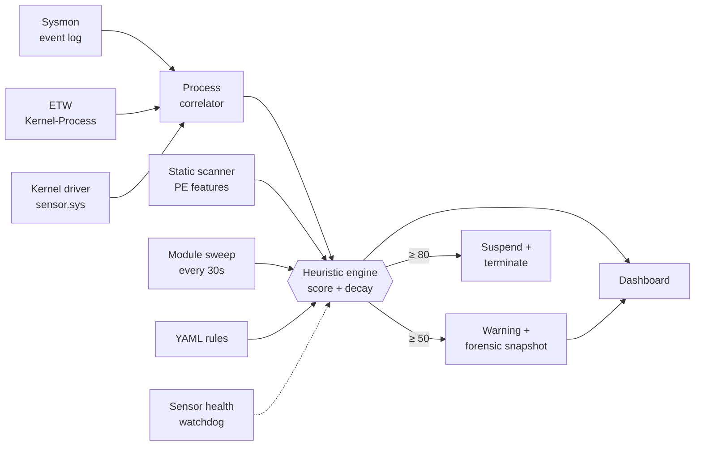

<div align="center">

# Windows Defensive Agent

**An open-source Windows EDR that treats sensor blind spots as detection signals.**

Sysmon · raw ETW · custom kernel driver — fused into one scored engine.


[Quick start](#-quick-start) · [How it works](#-how-it-works) · [Evasion matrix](#-evasion-matrix) · [Dashboard](#-dashboard) · [Deep dive](docs/internals.md)

</div>

---

## Why

Every Windows telemetry source lies by omission. Sysmon and ETW only report a
process's **claimed** parent, so parent-PID spoofing walks past them. ETW and
the driver carry **no command line**. PPL hides some LSASS handle requests even
from a kernel driver.

This agent runs all three sensors at once and asks: *which attacks does each
one miss, and does fusion recover them?* The answers are measured, not assumed
— see the [evasion matrix](reports/evasion_matrix.md).

## Features

| | |
|---|---|
| **Three fused sensors** | Sysmon, ETW `Kernel-Process`, and a WDM kernel driver, correlated by PID |
| **Kernel ground truth** | Real process creator vs. claimed parent (unspoofable), LSASS handle requests, driver loads |
| **Self-protection** | The driver strips terminate/inject rights from handles to the agent, so `taskkill /F` fails |
| **Scored engine** | Per-process score with decay; warn at 50, suspend + terminate at 80 |
| **Static analysis** | PE structure, import patterns, entropy, imphash intel, metamorphic clones — never executes samples |
| **Active sweep** | Finds staged DLLs and anonymous RWX (shellcode-shaped) memory, with first-seen dwell time |
| **Forensics** | Process-ancestry graph captured at detection time and kept after the process dies |
| **Honest visibility** | HEALTHY / DEGRADED / BLIND states, so "0 alerts" is never mistaken for "clean" |
| **Custom rules** | Drop a YAML file in `rules/custom/`; no code, no eval |
| **Local dashboard** | Live detections, processes, static verdicts, Process Explorer, rules |

## How it works



### What each sensor sees

| | Sysmon | ETW | Kernel driver |
|---|:-:|:-:|:-:|
| Command line | ✅ | ❌ | ❌ |
| Parent image path | ✅ | ❌ | ❌ |
| Claimed parent PID | ✅ | ✅ | ✅ |
| **Real** creator PID | ❌ | ❌ | ✅ |
| LSASS handle requests | ✅ ¹ | ❌ | ✅ ¹ |
| Kernel driver loads | ❌ | ❌ | ✅ |
| Needs Sysmon installed | yes | no | no |

¹ Neither sees a non-elevated `OpenProcess` on LSASS: PPL rejects it before any callback runs.

If ETW and Sysmon disagree about a parent PID, the correlator logs
`[TELEMETRY_CONTRADICTION]` instead of silently picking one.

## Detections

| Detection | Score | Technique |
|---|:-:|---|
| Defender tampering command line | 90 | T1562.001 |
| Kernel-verified PPID spoofing | 80 (20 if creator is a System32 broker) | T1134.004 |
| Ransomware-style file-write burst | 80 | T1486 |
| LSASS access | 70 (30 if caller is in System32) | T1003.001 |
| Office app → shell / script host | 60 | T1204.002 |
| `svchost.exe` hollowing-style access | 50 (15 if trusted) | T1055.012 |
| Obfuscated / download-execute PowerShell | 45 | T1059.001 |
| Run-key persistence | 40 | T1547.001 |
| Execution from staging directory | 30 | T1036 |
| Kernel driver loaded | 20 | — |
| Injected module / anonymous RWX region | 35–60 | T1055 |
| Static PE findings (RWX, entropy, injection / LSASS-dump / AMSI / ETW-patch IAT, imphash match, …) | 25–70 | various |

Sigma and YARA equivalents live in [`rules/`](rules/). A positively identified
**Cobalt Strike** stager is tagged `[HANDS-ON THREAT]` and pinned to the top of
the dashboard.

## Safety

This agent can kill processes. Two real incidents shaped it: a ransomware rule
that killed an IDE twice, and a false positive that suspended `csrss.exe` and
froze the OS.

- **Protected floor** — core OS processes, PIDs 0/4 and the agent itself can
  never be scored or mitigated. Enforced twice (scoring and `mitigate()`), and
  ported into the driver.
- **Hardcoded safety constants** — protected list, access masks and tamper
  patterns can't be loosened from the config file.
- **Scoped rules** — command-line rules only inspect processes that actually
  execute such commands; ransomware rule covers user document folders and
  excludes dev tools.
- **Trusted-broker discount** — Windows' own COM/app brokers legitimately
  reparent children; this fixed a false positive that killed a live Outlook.

To observe without risk, comment out the `self.mitigate(pid)` call in
`HeuristicEngine._check_threshold()`.

## Quick start

> Windows, Python 3.11+, run **elevated**. Use a disposable VM if you build the driver.

```powershell
git clone https://github.com/praneet390/Entity_2.0
cd Entity_2.0
python -m venv .venv
.venv\Scripts\pip install pefile psutil pywin32 pyyaml pywintrace
```

**1. Sysmon** (download separately; the binaries are not in the repo):

```powershell
Invoke-WebRequest -Uri "https://download.sysinternals.com/files/Sysmon.zip" -OutFile Sysmon.zip
Expand-Archive Sysmon.zip -DestinationPath tools\sysmon -Force
cd tools\sysmon; .\Sysmon64.exe -accepteula -i config.xml
```

**2. Kernel driver** *(optional — without it the agent runs on Sysmon + ETW)*

1. Build `driver/sensor/sensor.vcxproj` (x64, Debug) with Visual Studio + WDK.
   Output: `driver/sensor/x64/Debug/sensor.sys`.
2. Sign it with a test certificate and trust that certificate in the VM.
3. `bcdedit /set testsigning on`, then reboot.

The agent creates and starts the `sensor` service itself.

**3. Run**

```powershell
cd src
..\.venv\Scripts\python.exe web_server.py   # dashboard at http://127.0.0.1:8787
..\.venv\Scripts\python.exe main.py         # headless CLI
python -m pytest                            # tests
```

Each sensor can fail to start independently; the rest keep working.

## Dashboard

Served on `127.0.0.1:8787` only (it exposes a kill endpoint). Self-elevates via UAC.

- **Detections** — live feed, severity tiles, detections-over-time and by-technique charts
- **Endpoint Processes** — scores, **Live** status, **Chain** (ancestry graph), Terminate
- **Static Analysis** — verdict per sample
- **Process Explorer** — every process launch with lineage and source (`etw` / `sysmon` / `fused` / `kernel`)
- **Rules** — loaded YAML rules with hit counts
- **Visibility badge** — sensor health, dropped events, and a banner when alert counts can't be trusted

## Custom rules

```yaml
id: custom_lolbin_from_appdata_roaming
applies_to: process_create   # process_create | process_access | file_create | registry_event | static_pe
technique: T1218
score: 35
match:
  all:
    - { field: image, op: contains, value: "\\appdata\\roaming\\" }
    - { field: image, op: contains, value: [rundll32.exe, regsvr32.exe, mshta.exe] }
message: "LOLBin '{image}' launched from AppData\\Roaming"
```

Operators: `equals`, `contains`, `in`, `not_in`, `regex`, `gt`, `lt`. Rules route
through the same engine, so the safety floor applies to them too.
Tunables (decay, thresholds, ransomware window, fuse window) are in
[`config/detection.yml`](config/detection.yml). A known-good SHA-256
allowlist can be placed at `data/known_good_hashes.json`.

## Testing the agent itself

| Tool | What it does | Where |
|---|---|---|
| `failure_lab.py` | Injects sensor faults (silence, queue flood, malformed input, parent-PID contradiction) and checks detection, fallback and recovery. Software-only, safe anywhere. | `src/` |
| `vm_eval.py` | Runs harmless technique emulations plus a benign corpus against the live agent and scores detected / missed / false positive. **Disposable VM only.** | `src/` |
| `driver/sensor/*_test.c` | Attack harnesses behind the evasion matrix. Documented Win32 APIs, nothing destructive. | `driver/sensor/` |

## Evasion matrix

Live-tested on a running agent with all three sensors up
([full report](reports/evasion_matrix.md)):

| Technique | Sysmon | ETW | Kernel | Result |
|---|:-:|:-:|:-:|---|
| PPID spoof, untrusted creator | ❌ | ❌ | ✅ | +80, caught only by the driver |
| PPID spoof, trusted System32 broker | ❌ | ❌ | ✅ | +20, logged but not killed |
| `OpenProcess(VM_READ)` on LSASS, non-elevated | ❌ | n/a | ❌ | **nothing sees it** (PPL) |
| Defender tamper command line | ✅ | ❌ | ❌ | +90, needs Sysmon |
| Office → LOLBin | ✅ | ❌ | ❌ | +60, needs Sysmon |

The "Sysmon stopped" cells for the last two rows were not run live. The matrix
also records two scoring and fusion bugs it exposed and fixed.

## Threat intel

`tools/threat_intel_sync.py` pulls **metadata only** (imphash, family, tags) from
[MalwareBazaar](https://bazaar.abuse.ch) into `data/known_imphashes.json`. It
never downloads sample binaries.

```powershell
$env:MALWAREBAZAAR_AUTH_KEY = "..."   # free key from auth.abuse.ch; never commit it
python tools\threat_intel_sync.py --recent 100
```

Static features come from `tools/extract_features.py`, which parses PE bytes
and never executes a sample.

## Limitations

- The driver is **test-signed**, not attestation- or ELAM-signed, and uses a
  placeholder `ObRegisterCallbacks` altitude. It can't stop an admin's `sc stop`.
- No sensor sees a non-elevated `OpenProcess` on LSASS.
- ETW and the driver carry no command line or parent image; command-line rules
  need Sysmon.
- The sensor watchdog is observe-only and never restarts a dead sensor.
- Scoring is keyed on PID (with a start-time reuse guard), not `ProcessGuid`.
- Defender-tamper and PowerShell rules match text, not intent, so some benign
  commands (e.g. a read-only `Get-MpPreference`) can still be flagged.
- No rules yet for scheduled-task / service persistence, shadow-copy deletion
  or certutil abuse.
- Sysmon EventID 7 has a Sigma rule but no engine handler; `module_inspector.py`
  covers that case.
- The "memory snapshot" at score 50 is a log line, not a capture.

More detail: [docs/internals.md](docs/internals.md).

## Layout

```
src/        agent, sensors, engine, dashboard server + tests
  webapp/   dashboard frontend (HTML / CSS / JS)
driver/     sensor.c kernel driver + attack/test harnesses
rules/      sigma.yml, static.yar, family_signatures.yar, custom/*.yml
config/     detection.yml
tools/      extract_features.py, threat_intel_sync.py, sysmon/config.xml
data/       binaries.json, known_imphashes.json
reports/    malware write-ups, evasion_matrix.md
docs/       internals.md (full design notes)
```

## Credits

Detection ideas from [Fibratus](https://github.com/rabbitstack/fibratus) and
[System Informer](https://github.com/winsiderss/systeminformer); ETW capture via
[pywintrace](https://github.com/fireeye/pywintrace); threat intel from
[MalwareBazaar](https://bazaar.abuse.ch). No code was copied.

## License

[MIT](LICENSE)
